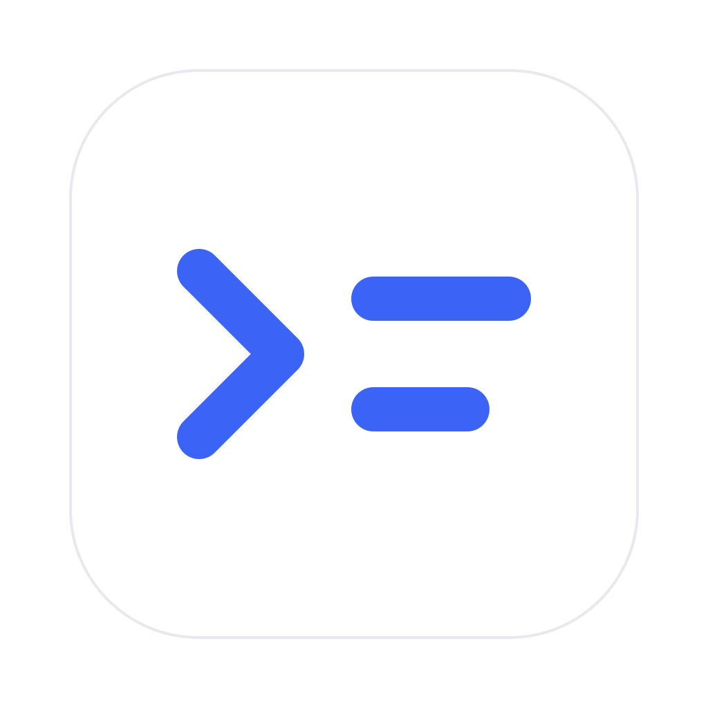

<p align="center"></p>

# Transcrilator

Lokaler Englisch-Deutsch-Übersetzer für Transkripte. Fügt ein englisches Transkript ein und erhält eine vollständige, sauber gegliederte deutsche Übersetzung mit Absätzen, fetten Überschriften und kursiven Kernaussagen. Die App läuft komplett auf dem eigenen Rechner und nutzt das **eigene** Abo jeder Person:

- **Claude** (voreingestellt) über das offizielle, separat installierte [Claude Code](https://code.claude.com/docs/en/overview) mit eigenem Claude-Plan
- **ChatGPT** über die offizielle OpenAI-Anmeldung mit eigenem ChatGPT-Plan

Es gibt keinen eigenen App-Login, keine API-Key-Eingabe und keine API-Ausweichroute. MIT-lizenziert.

## Installation (macOS)

1. Unter [Releases](../../releases/latest) `Transcrilator-<Version>-arm64.dmg` laden. Sie ist für Macs mit Apple Silicon (M1 und neuer). Für Intel-Macs gibt es vorerst keine fertige App; dort die Browser-Variante nutzen oder selbst mit `npm run dist:mac` bauen.
2. DMG öffnen und `Transcrilator` in den Ordner `Programme` ziehen.
3. Die App ist nicht von Apple signiert. Beim ersten Start meldet macOS deshalb, dass die App nicht geöffnet werden kann. Dann einmalig: **Systemeinstellungen → Datenschutz & Sicherheit → nach unten scrollen → „Dennoch öffnen“** und mit dem eigenen Mac-Passwort bestätigen. Danach startet sie normal.

Windows und Linux sind nicht gebaut und nicht getestet. Dort funktioniert die Browser-Variante (siehe unten).

Wenn die App schon installiert ist und eine neue Version erscheint: neue DMG laden und die alte App in `Programme` ersetzen. Einstellungen bleiben erhalten.

## Claude einrichten (einmalig pro Person)

1. Claude Code nach der [offiziellen Anleitung](https://code.claude.com/docs/en/setup) installieren, zum Beispiel im Terminal:
   ```sh
   curl -fsSL https://claude.ai/install.sh | bash
   ```
2. Mit dem **eigenen** Claude-Abo anmelden (Pro, Max, Team oder Enterprise):
   ```sh
   claude auth login --claudeai
   ```
   Die Anmeldung läuft vollständig in Anthropics eigenem Browser-Login. Die App sieht keine Passwörter oder Tokens.
3. Transcrilator öffnen. Unter Einstellungen (Symbol oben mittig) zeigt der Anbieter-Schalter `Claude | ChatGPT` dann bei Claude einen grünen Punkt und darunter „Verbunden über dein Claude-Abo“. Gelb heißt: noch nicht mit dem Abo angemeldet; rot: Claude Code nicht gefunden. `Neu verbinden` öffnet auf dem Mac das Terminal mit dem offiziellen `claude auth login`; beim ersten Mal fragt macOS, ob Transcrilator das Terminal steuern darf.

Die App akzeptiert nur die Abo-Anmeldung (`claude.ai`). Ein API-Key, Bedrock/Vertex oder fremde Zugangsdaten werden nicht verwendet, und kostenrelevante Umgebungsvariablen werden nicht an Claude Code weitergegeben. Übersetzungen zählen gegen das Nutzungslimit des eigenen Abos. Jede Person braucht ein eigenes Abo; Zugänge dürfen nicht geteilt werden.

## ChatGPT verwenden (optional)

In den Einstellungen im Anbieter-Schalter `ChatGPT` wählen und `Continue with ChatGPT` wählen; derselbe Button verbindet später neu. Nach einer kurzen Erklärung öffnet sich die offizielle OpenAI-Anmeldung im Standardbrowser. Dort anmelden und die Plannutzung freigeben, danach zur App zurückwechseln. Die Wahl des Anbieters wird gemerkt. Solange ChatGPT genutzt wird, steht unter dem Arbeitsbereich der von OpenAI vorgeschriebene Hinweis „ChatGPT-Plan · Nutzung“.

Tokens liegen nur im Arbeitsspeicher der laufenden App und werden beim Beenden verworfen; nach etwa einer Stunde ist eine neue Anmeldung nötig. Gespeichert werden nur eine Host-ID, die Registrierungskennung und die bestätigte Konto-ID, in der Desktop-App unter `~/Library/Application Support/Transcrilator/runtime`. Die zugrunde liegende OpenAI-Funktion ist eine [Preview](https://developers.openai.com/siwc/token-sharing-open-source/preview-limitations); Verfügbarkeit und Limits bestimmt OpenAI.

## Bedienung

- Text im Tab `Englisch` einfügen, `Übersetzen` oder Cmd+Enter. Das Eingabefeld ist eine mittige Karte; geschrieben und eingefügt wird oben links, langer Text scrollt innerhalb der Karte.
- Während der Übersetzung erzählen wechselnde kleine Sätze mit passender Animation, was gerade mit dem Skript passiert; Balken und bei langen Texten „x von y Teilen fertig“ zeigen den echten Fortschritt. Der Ladezustand endet genau dann, wenn die Übersetzung fertig ist.
- Erst wenn die Übersetzung vollständig ist, wechselt die Ansicht auf `Deutsch` und der Text wird automatisch in die Zwischenablage kopiert (kurzer Hinweis „In die Zwischenablage kopiert“). In der Desktop-App klappt das auch, wenn das Fenster inzwischen im Hintergrund ist. Blockiert ein Browser das automatische Kopieren, übernimmt der Button `Kopieren` das. Kopiert wird mit Formatierung (fett/kursiv) für Programme, die das unterstützen, sonst als reiner Text ohne Sternchen.
- `Clear` leert beide Seiten. Während der Übersetzung bricht der Button ab.
- Der Übersetzungsprompt liegt unter Einstellungen → Prompt. Das Stift-Symbol schaltet die Bearbeitung frei, `Zurücksetzen` stellt den Standard wieder her.

## Kurzbefehle

| Aktion | Mac |
|---|---|
| Übersetzen bzw. Kopieren (Hauptaktion) | ⌘ ↩ |
| Text einfügen, ohne vorher ins Feld zu klicken | ⌘ V |
| Fertige Übersetzung kopieren | ⌘ C |
| Zwischen Englisch und Deutsch wechseln | ⌃ Tab oder ⌘ ⇧ [ / ] |
| Einstellungen öffnen | ⌘ , |

⌘ Tab gehört macOS für den Programmwechsel und kann von keiner App genutzt werden. Die Übersicht steht auch in den Einstellungen hinter dem ⌘-Symbol; beim kurzen Zeigen mit der Maus erscheint der jeweilige Kurzbefehl klein unter dem Element. Unter Windows und Linux gilt Strg statt ⌘. In der Browser-Variante kann der Browser einzelne Kurzbefehle wie ⌃ Tab selbst belegen.

## Grenzen und Verlässlichkeit

- Bis zu 500.000 Zeichen pro Übersetzung. Nichts wird still abgeschnitten.
- Texte werden verlustfrei in Teile von höchstens 6.000 Zeichen zerlegt, bevorzugt an Absatz- oder Satzgrenzen. Claude übersetzt bis zu drei Teile gleichzeitig, ChatGPT nacheinander. Die Teile werden in Originalreihenfolge zusammengesetzt.
- Scheitert ein Teil (Limit, Timeout von 180 Sekunden, Abbruch, unvollständige Antwort), wird die gesamte Übersetzung verworfen. Ein Teilergebnis wird nie als fertig angezeigt.
- Diese Prüfungen sichern Vollständigkeit und Reihenfolge der Übertragung. Ob ein Sprachmodell jede Nuance richtig übersetzt, muss am Ergebnis geprüft werden.

## Browser-Variante und Entwicklung

Voraussetzung: Node.js 24 oder neuer.

```sh
npm start
```

Dann http://127.0.0.1:4317 öffnen (anderer Port: `PORT=4319 npm start`). Auf dem Mac geht auch ein Doppelklick auf `Start.command`. Der Server bindet ausschließlich an 127.0.0.1, prüft Host, Origin und ein CSRF-Token und ist nicht aus dem Netzwerk erreichbar. Der Server selbst hat keine Paketabhängigkeiten.

Desktop-App lokal starten und bauen (benötigt `npm install` für Electron und electron-builder):

```sh
npm install
npm run desktop     # App aus dem Quellcode starten
npm run dist:mac    # DMG und ZIP für arm64 und x64 nach dist/
```

Tests:

```sh
npm run check
npm test
```

Die Tests decken OAuth/JWKS-Prüfung, Origin/CSRF/Host, verlustfreies Chunking, Stream-Abschlüsse, Abbruch und Fehler, den exakten Standardprompt sowie den isolierten Claude-Adapter ab (inklusive paralleler Teile). Sie verwenden nur synthetische Antworten.

## Wie die Claude-Anbindung arbeitet

Pro Textteil startet die App das unveränderte `claude`-Programm ohne Shell in einem leeren temporären Ordner, mit `--safe-mode`, ohne Tools und MCP-Server, ohne Sitzungsspeicherung und mit dem Prompt als Systemprompt. Der Quelltext geht über stdin. Vorher prüft sie die unterstützten Sicherheitsoptionen und mit `claude auth status`, dass eine Abo-Anmeldung vorliegt. Nur eine vollständige, erfolgreiche JSON-Antwort wird übernommen.

Die App bringt Claude Code nicht mit und bietet keinen eigenen Claude-Login an. Das entspricht den Vorgaben in Anthropics [Legal and Compliance](https://code.claude.com/docs/en/legal-and-compliance): Endnutzer melden sich selbst im unveränderten Claude Code mit ihrem eigenen Abo an. Transcrilator ist ein unabhängiges Projekt und nicht von Anthropic oder OpenAI.

## Offizielle Quellen

- Claude Code: [CLI-Referenz](https://code.claude.com/docs/en/cli-reference), [Headless](https://code.claude.com/docs/en/headless), [Legal and Compliance](https://code.claude.com/docs/en/legal-and-compliance), [Claude-Plan mit Agent SDK](https://support.claude.com/en/articles/15036540-use-the-claude-agent-sdk-with-your-claude-plan)
- OpenAI: [Überblick](https://developers.openai.com/siwc/token-sharing-open-source), [Anmeldung](https://developers.openai.com/siwc/token-sharing-open-source/sign-in), [Modelle und Inferenz](https://developers.openai.com/siwc/token-sharing-open-source/models-and-inference), [Tokenreferenz](https://developers.openai.com/siwc/token-sharing-open-source/token-reference), [Preview-Grenzen](https://developers.openai.com/siwc/token-sharing-open-source/preview-limitations), [UI-Hinweise](https://developers.openai.com/siwc/ui-ux-guidelines)

OAuth nutzt Authorization Code mit PKCE, dynamische Registrierung beim ersten Mal, stabile Host-ID, state/nonce und RS256-ID-Token-Prüfung per offizieller JWKS. Callback: `http://127.0.0.1:<Port>/auth/callback`. Inferenz läuft über `https://api.openai.com/v1/responses` mit `store:false` und `stream:true`.
